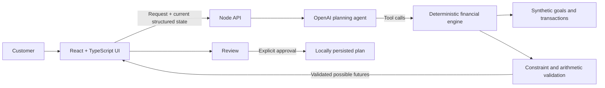

# Money Moves — Life Happens

**One goal. Multiple possible futures. Human choice.**

Money Moves is an AI-native financial planning prototype inside a fictional ABC Bank experience. It helps customers describe a real-life change in natural language, converts that request into editable constraints, and presents financially valid futures they can compare before choosing a plan.

The main journey is:

**Home → Spending insight → Life Happens → Possible Futures → Review → Active Plan**

## Run the app

Requires Node.js 22.6 or newer.

```sh
npm install
npm run dev
```

Open [http://127.0.0.1:5173](http://127.0.0.1:5173).

The app works without an API key in clearly labeled **Example mode**. To use the live planning agent, copy `.env.example` to `.env` and add an `OPENAI_API_KEY`. The key is used only by the Node server.

## Run the checks

```sh
# Deterministic finance and mocked-agent tests
npm test

# TypeScript and production build
npm run build

# Optional live-model evaluation; requires OPENAI_API_KEY
npm run test:live
```

The live suite makes paid API calls and does not accept fallback behavior as a passing live result.

## Flagship demo

1. On Home, select **See what changed**.
2. Review the dining evidence, then select **Explore my options**.
3. In Life Happens, choose **Unexpected expense** to enter:

   > I have a wedding next month and need an extra $200. I don't want to cut dining because that's how I spend time with friends. Can I still reach my vacation goal?

4. Select **Explore futures**.
5. Inspect the interpreted situation: wedding, amount, timing, protected dining, and the visible funding assumption.
6. Compare the calculated paths:

   | Future | Monthly savings | Spending change | Goal date |
   | --- | ---: | --- | --- |
   | Keep your date | $120 | Shopping −$60/month | March 23, 2027 |
   | A balanced path | $100 | Shopping −$40/month | April 23, 2027 |
   | Keep your lifestyle | $60 | No new reduction | August 23, 2027 |

7. Select different futures and watch the chart, completion date, category changes, evidence, and tradeoffs update together.
8. Follow up with:

   > Actually, I could reduce shopping by $30, but I don't want to change my vacation date.

   The wedding and dining protection remain, while the shopping adjustment and deadline update.

9. Choose a valid future, select **Review selected future**, and explicitly activate the plan.
10. On Active Plan, demonstrate edit, pause, and resume controls.

Exploration never changes the active plan. No money is transferred automatically, and the prototype does not send real notifications.

## System architecture



### AI responsibilities

- Interpret flexible natural-language requests.
- Identify events, timing, priorities, and corrections.
- Distinguish hard constraints from preferences.
- Detect ambiguity and contradictions.
- Preserve structured context across follow-up requests.
- Select the appropriate financial tools.

### Deterministic responsibilities

- Aggregate transaction data.
- Calculate category baselines and adjustment capacity.
- Apply one-time expenses according to their funding source.
- Project balances, contributions, and completion dates.
- Enforce protected categories and spending limits.
- Generate, compare, and validate feasible paths.
- Reject arithmetic errors and impossible scenarios.

The model does not invent the amounts shown in the interface. It updates structured state and calls tools. The server returns tool-calculated scenarios, and the application validates a scenario again before activation.

## Agent tools

| Tool | Purpose |
| --- | --- |
| `get_financial_context()` | Returns the goal, checking balance, transactions, observed spending, limits, and reference date |
| `analyze_adjustable_spending({ state })` | Finds eligible categories while assigning zero capacity to protected categories |
| `generate_feasible_paths({ state })` | Simulates the event, creates candidate futures, validates them, and returns comparisons |

All three tools must complete before a live recommendation is accepted. Tool arguments and outputs are schema-validated. The UI’s transparency panel reports the tools that actually ran without exposing private chain-of-thought.

## Financial model

The demo uses synthetic data as of October 23, 2026:

- Vacation Fund: $400 saved toward $1,000
- Original target date: March 23, 2027
- Existing contribution: $60/month
- Checking balance: $8,452.80
- Dining: $320 this period versus a typical $200

Calculations use integer cents. Required monthly savings are rounded up to the nearest cent and allocated only across eligible discretionary categories within observed-spending and product limits.

The wedding’s funding source is explicit because each choice has a different result:

- **Checking:** pays the expense from checking while preserving goal savings.
- **Savings contribution:** reduces that month’s contribution.
- **Vacation Fund:** explicitly withdraws the expense from the goal balance.

Protected categories are never reduced silently. A hard deadline removes later alternatives. Impossible requests return no fabricated path.

## Key implementation files

| File | Responsibility |
| --- | --- |
| `App.tsx` | End-to-end journey, review, activation, navigation, and persistence |
| `LifeHappens.tsx` | Natural-language input, multi-turn updates, and scenario workspace |
| `LifeConstraints.tsx` | Editable priorities, event details, funding source, and flexibility |
| `FuturePaths.tsx` | Accessible interactive future-path visualization |
| `ScenarioDetails.tsx` | Selected-path summary, evidence, tradeoffs, and transparency |
| `life-agent.ts` | OpenAI tool loop and structured interpretation |
| `life.ts` | Financial simulation, path generation, and validation |
| `fixtures.ts` | Synthetic customer, goal, and transaction data |
| `server.ts` | Local API and request validation |
| `life.test.ts` | Deterministic, mocked-agent, multi-turn, and safety tests |
| `life.live.test.ts` | Optional live-model evaluation |

## Verification

- 22 deterministic and mocked-agent regression tests pass.
- All seven live-agent evaluation behaviors passed with the configured model on October 23, 2026.
- The production TypeScript/Vite build passes.
- Mobile and desktop browser QA covers all major states, including loading, scenario selection, review, activation, persistence, and pause/resume.

## Current scope

This is a focused prototype with synthetic financial data. It supports one life event, one exact shopping adjustment, and monthly projections. It does not include authentication, bank connections, real transfers, real notifications, investment returns, changing income, or future checking cash-flow forecasting.
